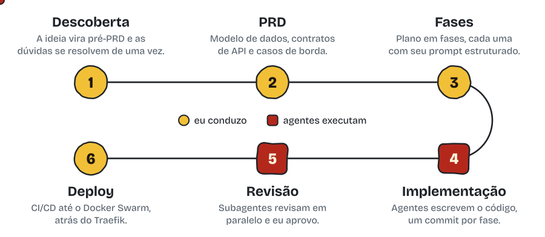
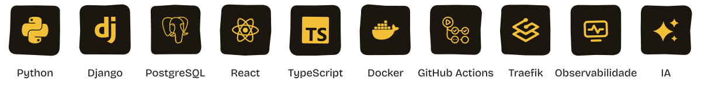
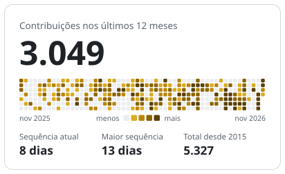
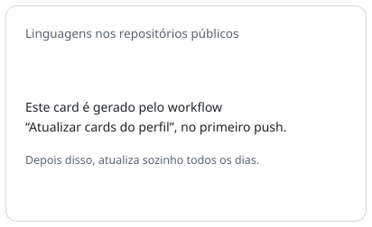

<!--
  As imagens que mudam com o tema (claro/escuro) usam URL absoluta dentro de <picture>,
  que é a forma documentada pelo GitHub. "HEAD" aponta sempre para o branch padrão.
-->

  <picture>
    <source media="(prefers-color-scheme: dark)" srcset="https://raw.githubusercontent.com/willamylp/willamylp/HEAD/assets/banner-dark.svg">
    <source media="(prefers-color-scheme: light)" srcset="https://raw.githubusercontent.com/willamylp/willamylp/HEAD/assets/banner-light.svg">
    
  </picture>

  
  &nbsp;
  

Desenvolvedor full-stack no interior do Rio Grande do Norte, trabalhando remotamente. Construo **SaaS multi-tenant** com Django e React, sistemas para a **saúde pública** e, cada vez mais, software feito junto com **agentes de IA**, da especificação ao deploy.

<b>Read this in English</b>

 

Full-stack developer based in Rio Grande do Norte, in Brazil's Northeast, working remotely. I build **multi-tenant SaaS** with Django and React, software for **public healthcare**, and more and more of it alongside **AI agents**, from the spec to the deploy.

**About**

- Bachelor's degree in **Information Systems** from **UFRN**.
- **Django and DRF** on the backend, **React with TypeScript** on the frontend, **PostgreSQL** for data.
- **Multi-tenant** architecture (one schema per customer, with django-tenants) and self-managed deploys on **Docker Swarm behind Traefik**.
- I also work in **data engineering** for the energy sector and with the information systems of **SUS**, Brazil's public health system.

**What I build**

| Project | What it is |
| --- | --- |
| **FiscPro** | Multi-tenant tax-intelligence SaaS for accounting firms. Django with one schema per customer, PostgreSQL with PgBouncer, deployed on Docker Swarm behind Traefik. |
| **Filanda** | Queue and call management for walk-in services: reception checks people in, staff call the next person with one click, and a TV panel announces the name out loud, in real time. |
| **MeuQDC** | Web editor for laying out electrical distribution boards, with breakers, RCDs, surge protectors and busbars. In progress. |
| **Clynus** | Hospital management on the web. |
| **SAPE&#8209;CRE** | Electronic health records for rehabilitation centers: scheduling, intake, waiting list and SUS billing. |

Open source: [sigtap-frontend](https://github.com/willamylp/sigtap-frontend) (lookup for the SUS procedures table), [docs-for-devs](https://github.com/willamylp/docs-for-devs) (hands-on guides for Docker deploys and environment setup) and [files-ftp-datasus](https://github.com/willamylp/files-ftp-datasus) (automatic download of DATASUS update files).

**AI and agentic development**

I treat agents as part of the team: I write the spec, decide the architecture and review; they execute.

- **Spec-driven development.** My own Claude Code skills for writing PRDs, building prompts and implementing in phases, with subagents reviewing in parallel and MCP servers connecting the tools. In the editor, Cursor and GitHub Copilot.
- **Autonomous agents.** I work with [Hermes Agent](https://github.com/NousResearch/hermes-agent), the open-source agent from Nous Research with persistent memory and skills, and build my own agents in LangChain, with tool use, orchestration and evals.
- **LLMs inside the product.** Features built on the Anthropic and OpenAI APIs in the systems I develop.

## Sobre

- Bacharel em **Sistemas de Informação** pela **UFRN**.
- **Django e DRF** no backend, **React com TypeScript** no frontend, **PostgreSQL** nos dados.
- Arquitetura **multi-tenant** (um schema por cliente, com django-tenants) e deploy próprio em **Docker Swarm atrás do Traefik**.
- Também atuo com **engenharia de dados** no setor de energia e com os sistemas de informação do **SUS**.

## O que eu construo

| Projeto | O que é |
| --- | --- |
| **FiscPro** | SaaS multi-tenant de inteligência fiscal para escritórios de contabilidade. Django com um schema por cliente, PostgreSQL com PgBouncer e deploy em Docker Swarm atrás do Traefik. |
| **Filanda** | Gestão de filas e chamadas para atendimento presencial: a recepção cadastra, o profissional chama com um clique e o painel da TV anuncia o nome por voz, em tempo real. |
| **MeuQDC** | Editor web para montar esquemas de quadros de distribuição elétrica, com disjuntores, IDR, DPS e barramentos. Em construção. |
| **Clynus** | Gestão hospitalar na web. |
| **SAPE&#8209;CRE** | Prontuário eletrônico para centros de reabilitação: agenda, escuta inicial, fila de espera e faturamento BPA-I. |

Código aberto:

- [sigtap-frontend](https://github.com/willamylp/sigtap-frontend): consulta à Tabela de Procedimentos do SUS (SIGTAP), com filtros e versionamento por competência.
- [docs-for-devs](https://github.com/willamylp/docs-for-devs): guias práticos de deploy com Docker e configuração de ambientes.
- [files-ftp-datasus](https://github.com/willamylp/files-ftp-datasus): download automático dos arquivos de atualização dos sistemas do DATASUS.

## IA e desenvolvimento com agentes

Trato os agentes como parte da equipe: eu especifico, decido a arquitetura e reviso; eles executam.

  <picture>
    <source media="(prefers-color-scheme: dark)" srcset="https://raw.githubusercontent.com/willamylp/willamylp/HEAD/assets/workflow-dark.svg">
    <source media="(prefers-color-scheme: light)" srcset="https://raw.githubusercontent.com/willamylp/willamylp/HEAD/assets/workflow-light.svg">
    
  </picture>

- **Desenvolvimento guiado por especificação.** Skills próprias no Claude Code para escrever PRDs, montar prompts e implementar em fases, com subagentes revisando em paralelo e servidores MCP conectando as ferramentas. No editor, Cursor e GitHub Copilot.
- **Agentes autônomos.** Trabalho com o [Hermes Agent](https://github.com/NousResearch/hermes-agent), o agente open source da Nous Research com memória persistente e skills, e construo agentes próprios em LangChain, com uso de ferramentas, orquestração e evals.
- **LLM dentro do produto.** Funcionalidades com as APIs da Anthropic e da OpenAI nos sistemas que desenvolvo.

## Stack

  <picture>
    <source media="(prefers-color-scheme: dark)" srcset="https://raw.githubusercontent.com/willamylp/willamylp/HEAD/assets/stack-dark.svg">
    <source media="(prefers-color-scheme: light)" srcset="https://raw.githubusercontent.com/willamylp/willamylp/HEAD/assets/stack-light.svg">
    
  </picture>

<!-- &nbsp; dentro de um nome composto impede que ele quebre no meio da linha. -->
| Área | Tecnologias |
| --- | --- |
| **Backend&nbsp;e&nbsp;dados** | <code>Python</code> <code>Django</code> <code>Django&nbsp;REST&nbsp;Framework</code> <code>django-tenants</code> <code>Django&nbsp;Channels</code> <code>PostgreSQL</code> <code>PgBouncer</code> <code>MinIO</code> <code>Stripe</code> <code>Flask</code> |
| **Frontend** | <code>TypeScript</code> <code>React</code> <code>Vite</code> <code>Tailwind&nbsp;CSS</code> <code>Bootstrap</code> <code>Django&nbsp;Templates</code> |
| **Infra&nbsp;e&nbsp;deploy** | <code>Docker</code> <code>Docker&nbsp;Swarm</code> <code>Traefik</code> <code>NGINX</code> <code>Gunicorn</code> <code>Uvicorn</code> <code>GitHub&nbsp;Actions</code> <code>Cloudflare</code> <code>AWS</code> |
| **IA&nbsp;e&nbsp;agentes** | <code>Claude&nbsp;Code</code> <code>Cursor</code> <code>GitHub&nbsp;Copilot</code> <code>Hermes&nbsp;Agent</code> <code>LangChain</code> <code>MCP</code> <code>Anthropic&nbsp;API</code> <code>OpenAI&nbsp;API</code> |

## GitHub em números

  <picture>
    <source media="(prefers-color-scheme: dark)" srcset="https://raw.githubusercontent.com/willamylp/willamylp/HEAD/assets/stats-dark.svg">
    <source media="(prefers-color-scheme: light)" srcset="https://raw.githubusercontent.com/willamylp/willamylp/HEAD/assets/stats-light.svg">
    
  </picture>
  <picture>
    <source media="(prefers-color-scheme: dark)" srcset="https://raw.githubusercontent.com/willamylp/willamylp/HEAD/assets/langs-dark.svg">
    <source media="(prefers-color-scheme: light)" srcset="https://raw.githubusercontent.com/willamylp/willamylp/HEAD/assets/langs-light.svg">
    
  </picture>

Os dois cards são gerados todo dia por um [workflow deste repositório](.github/workflows/profile-cards.yml), sem serviços de terceiros.

  <picture>
    <source media="(prefers-color-scheme: dark)" srcset="https://raw.githubusercontent.com/willamylp/willamylp/HEAD/assets/footer-dark.svg">
    <source media="(prefers-color-scheme: light)" srcset="https://raw.githubusercontent.com/willamylp/willamylp/HEAD/assets/footer-light.svg">
    
  </picture>

